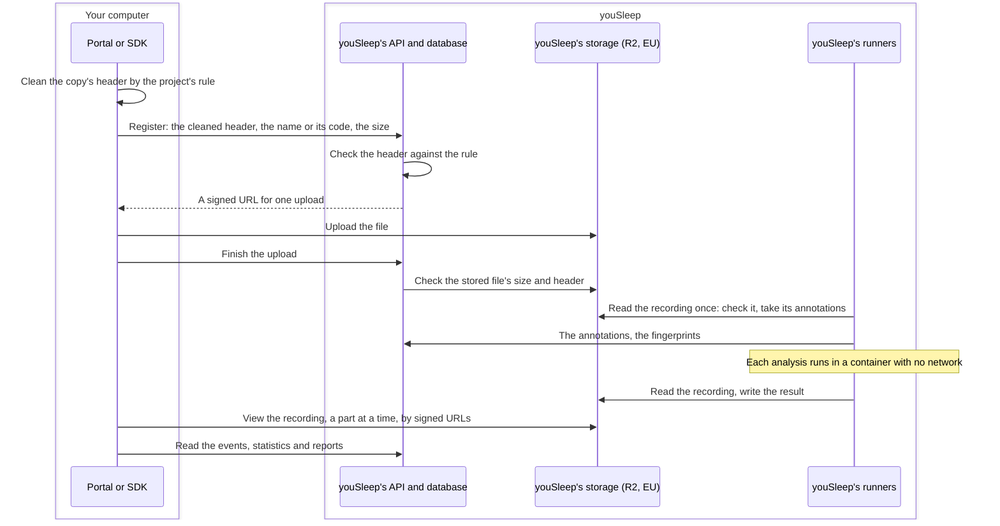

# How data flows

This page follows a recording through youSleep: where it goes, what is kept,
and how it is deleted. A project's recordings are kept either in youSleep's
storage or, for an organisation that has set up its own site, in the
organisation's own storage. A project's place is fixed when it is created.

## What is where

| Data | Where it is kept |
|---|---|
| Account data: name, email address, organisation, usage | youSleep's database, on youSleep's server in Denmark |
| Recordings (EDF files), pseudonymised | youSleep's storage (Cloudflare R2, EU region), or the organisation's own storage |
| A recording's header, cleaned, and what is entered about its study | youSleep's database |
| Annotations read from a recording | youSleep's database: their times and labels. For a recording in youSleep's storage, also the text of one that matches no known label; for a recording kept at a site, never its free text |
| Analysis results | youSleep's storage (Cloudflare R2, EU region) |
| Backups | Cloudflare R2: the database, and copies of results and logs. Not the recordings |
| Messages to youSleep's staff | youSleep's database, with the account. Email to `contact@yousleep.ai` is in youSleep's mailbox, hosted by Google Workspace |

## Pseudonymisation

Each project has a pseudonymisation rule, chosen when the project is created
and fixed afterwards:

- **Always:** the patient and recording identification fields in a
  recording's EDF header are blanked. They can hold a name, a patient code, a
  date of birth, a hospital or an investigator.
- **Where the project removes dates:** the recording's start date is replaced
  with the EDF+ marker for an unknown date. The time of day is kept.
- **Where the project codes file names:** youSleep issues a code that replaces
  each file's name. The user keeps the map of names to codes; youSleep keeps
  no copy of it.

The portal and the Python SDK apply the rule **on the user's own computer**,
to the copy being uploaded, so the removed fields never reach youSleep. The
server checks every header against the project's rule twice: when a
recording is registered, and once the file is stored. A file that does not
follow the rule is refused and deleted, and its header is neither logged nor
kept.

The rule covers the EDF header only. The signals, annotation text inside the
file, and what users enter about a study are not changed, and must not
identify anyone.

## A recording in youSleep's storage

- **Upload.** The file goes straight from the user's computer to youSleep's
  storage, with a URL youSleep signs for that one upload.
- **Analysis.** youSleep's runners, on youSleep's server, run each analysis in
  a container with no network, as an unprivileged user. The container reads
  the recording and writes one result; the runner moves both. The runner
  deletes its copy of the recording when the run ends.
- **Viewing and export.** The portal reads the recording from storage a part
  at a time. Results are read through the API. A user can download the
  recordings they uploaded and export events and reports.

## A recording kept at your site

When an organisation keeps a project's recordings in its own storage and runs
its analyses with youSleep's runner on its own hardware, the signals never
reach youSleep. Browsers on the organisation's network and its runner reach
the storage with requests youSleep signs; youSleep's servers never connect to
it. youSleep keeps the cleaned header, the name or its code, the file's size
and fingerprints, the annotations' times and labels without their free text,
and the analysis results.

The runner's [Data and security](../components/runner/data-and-security.md)
page shows these flows step by step, with what the runner sends and what stays
at the site.

## Deletion

| When | What happens |
|---|---|
| A user deletes a recording, study, analysis or project | It leaves the live systems at once. Its file is deleted from youSleep's storage. A file uploaded into an organisation's own storage is deleted from it by the organisation's runner; a file registered where it already was is only unregistered, never deleted |
| An organisation stays over its free storage for 30 days | After email warnings, its most recently uploaded recordings are deleted until it is back within its limit |
| An account is deleted, or unused for 24 months | Its account record, conversations, private projects and their results are deleted. What it shared stays with its organisation |
| Data has been deleted | It ages out of every backup within 35 days |
| An object in youSleep's storage is no longer tracked | The storage itself deletes it within 60 days |

A few records survive an account's deletion, in de-linked or minimised form,
for stated purposes: a deletion record, the record of legal documents accepted,
the credit ledger with a minimal record of each analysis run (without its
results), and usage statistics. The
[Privacy Policy](https://portal.yousleep.ai/legal/privacy-policy) (section 5.4)
lists them.

## Who can read what

- **A recording and its results:** the user who uploaded it; the members of
  their organisation if the project was made visible to the organisation or
  shared with them; and youSleep's staff, who operate the service.
- **Account data:** the account itself, the members of its organisation (name
  and email address), and youSleep's staff.
- **Nobody outside the organisation.** Sharing never reaches beyond it.
  Recordings are not sold, not used for advertising, and not used to train or
  improve models.
